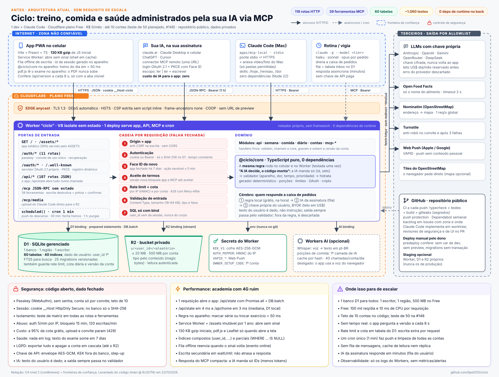

# Arquitetura

O desenho acima ([`arquitetura/detalhada/atual.svg`](arquitetura/detalhada/atual.svg)) é um diagrama C4 nível 2 (contêineres) com as fronteiras de confiança. Foi levantado do código em 22/11/2026 (main @ `6c327f4`). Há também uma versão resumida para apresentar e postar ([`arquitetura/resumida/atual.svg`](arquitetura/resumida/atual.svg)): estilo prancheta, nas cores do Ciclo, sem detalhe interno. Ela já mostra o teto do teste fechado (≤ 50, #148). A proposta para escalar a milhões de contas, com decisões, o que foi conferido na documentação oficial e a ordem de migração, está em [`arquitetura/futura.md`](arquitetura/futura.md). Quando uma peça mudar, atualize os SVGs e esta página no mesmo PR.

## Peças
| Peça | O que é | Dependências de runtime |
|---|---|---|
| `packages/core` | Regras puras em TS: catálogo, semana flexível (`planDay`), gerador determinístico, sessão (2 h), cargas, validador/hidratação, porções, limites, OAuth, cripto do cofre de chaves | **nenhuma** |
| `apps/web` | PWA em Vite + Preact + TS (ADR-0008), uma tela por pasta em `src/screens/`, compartilhados em `src/lib/`. O core é importado direto e roda no aparelho | Preact; pdf.js e Leaflet só sob demanda (ADR-0009, ADR-0010) |
| `apps/worker` | Um Worker só: serve o app (`ASSETS`), `/auth/*`, `/oauth/*`, `/api/*`, `/mcp`, `/mcp/media` e o cron. Roteador próprio, migrations D1, testes em `test/` (D1 em memória via `node:sqlite`) | só `@ciclo/core` |
| `apps/mcp-local` | Ponte stdio ⇄ HTTPS para o Claude Code, mais o upload de arquivo do Mac (pastas permitidas) | nenhuma (Node 22) |
| `.claude/` | Skills, subagentes (`implementer`, `guarda-seguranca`, `ui-reviewer`) e o modelo por tarefa | — |

**Números (22/11/2026):** 107 rotas em `/api`, 11 em `/auth`, 39 ferramentas MCP (contrato 1.4.0), 60 tabelas, 40 índices, 25 migrations e 1.000 testes.

## Zonas de confiança
1. **Internet (não confiável):** o app no celular, a IA da pessoa (claude.ai, Claude Desktop/celular, ChatGPT, Cursor), o Claude Code com `apps/mcp-local` e a rotina/vigia (`claude -p`).
2. **Cloudflare (plano Free):** o edge (TLS, DDoS, cabeçalhos de `_headers`), o Worker e os serviços ligados por binding: D1, R2, Workers AI (opcional) e os secrets.
3. **Terceiros (saída por allowlist):** provedores de LLM com a chave da pessoa (Anthropic, OpenAI, Gemini, OpenRouter, DeepSeek), Open Food Facts, Nominatim, Turnstile e os serviços de Web Push. Os tiles do OpenStreetMap são pedidos pelo navegador, direto.

## Cadeia de cada requisição (`apps/worker/src/index.ts`)
1. **Origin** igual ao do app em toda escrita (anti-CSRF; sem CORS).
2. **Autenticação:** cookie `__Host-ciclo` (passkey, ADR-0011) no app; Bearer do MCP (chave manual ou token OAuth de 1 h, ADR-0013). Só o SHA-256 fica no D1, com comparação em tempo constante.
3. **Face ID de novo** se o app ficou 7 dias fechado; ações sensíveis pedem Face ID dos últimos 5 min.
4. **Aceite** da versão vigente dos termos e da privacidade (app e MCP bloqueiam até aceitar).
5. **Rate limit e cota** por IP (HMAC com `AUTH_PEPPER`) e por conta, no D1 (ADR-0012).
6. **Validação de entrada** com os helpers de `http.ts` (Content-Type, tamanho, tipo e faixa).
7. **SQL só com `bind`**, sempre com o `user_id` da sessão, nunca do corpo (ADR-0007).

Detalhes em `03-seguranca.md`.

## Decisões (ADRs em `docs/adr/`)
1. **Cloudflare grátis** (Workers + D1 + R2): o app abre na academia com o Mac desligado, ADR-0001.
2. **Core puro compartilhado:** o mesmo `planDay` roda no celular (offline) e no servidor (MCP), ADR-0002.
3. **Front em Vite + Preact** desde a #22 (substituiu o "sem framework" do ADR-0003), ADR-0008.
4. **MCP mínimo próprio** (JSON-RPC sem estado, respostas JSON), sem SDK nem Durable Objects, ADR-0004.
5. **O Claude decide, o código monta:** a IA manda `{id, sets}`, o core valida e hidrata, ADR-0005.
6. **Modelo por pedido** (Haiku, Sonnet, Opus) na caixa e nas skills, ADR-0006.
7. **Contas e isolamento:** todo dado tem `user_id`, ADR-0007.
8. **Login próprio por passkey**, conta só por convite, teto de 10 contas (teste fechado de até 50 planejado na #148), ADR-0011. O Cloudflare Access saiu (#62).
9. **OAuth 2.1 do MCP** (PKCE, registro dinâmico) e o "cérebro" que responde a caixa, ADR-0013.
10. **Chave de API própria (BYOK)** com envelope AES-256-GCM e teto em US$, ADR-0015.

## Fluxos principais
**Abrir o app na academia**
1. O Service Worker entrega o shell em cache (abre sem sinal).
2. `GET /api/state?date=` traz tudo numa chamada só (`Promise.all` + `DB.batch`).
3. O `@ciclo/core` calcula o treino do dia **no aparelho**.
4. Com a aba visível, o app confere `GET /api/version` a cada 8 s. Se a versão da conta mudou (escrita do Claude, outro aparelho), recarrega os dados no lugar (#114).

**Treinar**
1. `POST /api/sessions` grava a presença ("começou = fui"). O id da sessão nasce no aparelho, então as séries entram na **fila offline** mesmo antes de a sessão chegar ao servidor.
2. Cada série vai em `POST /api/sessions/:id/sets`. O fim vai em `/finish`, ou o cron fecha sozinho em 2 h.
3. O fim do descanso chega por Web Push (cron de 1 min), sem conteúdo pessoal no push.

**Pedido à IA (caixa)**
1. `POST /api/inbox` grava o texto com a ação e o modelo.
2. O cérebro tenta, nesta ordem: **regra local** (grátis, na hora), a **IA da assinatura** (o pedido fica na fila até a rotina/vigia ou o chat com o connector chamar `ciclo_chat_pendentes`) e, se a pessoa cadastrou, a **chave própria** (BYOK, com teto).
3. `ciclo_responder_pedido` grava a resposta e, se houver itens, salva o treino do dia **validado**.
4. O app mostra a resposta com o diff e o botão **Aplicar**.

**Edição manual**
1. O validador roda no aparelho.
2. `PUT /api/day-plan/:date`, e `POST /api/plan-edits` (o servidor reaplica e valida).
3. A edição fica pendente até o Claude chamar `ciclo_revisar_edicoes` e `ciclo_concluir_revisao`.

**Mídia**
1. O arquivo vai por `POST /api/media` (app) ou `/mcp/media` (Claude Code) direto para o R2, com tipo pelo conteúdo (magic bytes) e até 20 MB.
2. O app lê de volta por `GET /api/media/:id`, autenticado. O bucket é privado.

**Exame**
1. O PDF é lido **no aparelho** (pdf.js). Só o texto vai ao D1.
2. O texto bruto some na análise (`ciclo_exame_concluir`) ou em 7 dias (cron). Fica só o resumo estruturado.

## Cron (`scheduled`, 1 min)
| Quando | O quê |
|---|---|
| todo minuto | Web Push do fim do descanso (`rest_timer` com índice parcial) |
| a cada 30 min | fecha treinos esquecidos (máx. 2 h) e apaga texto bruto de exame vencido |
| a cada hora | lixeira de 30 dias (inclui o R2), sessões e desafios de login vencidos, limites antigos, OAuth vencido, prévias do MCP |

## Modelo de dados (D1)
60 tabelas em 25 migrations (`apps/worker/migrations/`). Toda tabela com dado de pessoa tem `user_id`, e as chaves e os índices dela começam por ele. Sem seed: o banco nasce vazio.

| Grupo | Tabelas |
|---|---|
| Conta e acesso | `user` · `passkeys` · `sessions` · `invites` · `recovery_codes` · `auth_challenge` · `consent` · `ui_pref` · `conta_versao` |
| Conectores e IA | `mcp_token` · `oauth_client` · `oauth_request` · `oauth_code` · `mcp_previa` · `chave_ia` · `chave_ia_uso` · `chave_ia_evento` · `cerebro_gasto` · `claude_memory` · `claude_heartbeat` · `conversa` · `conversa_msg` · `inbox` |
| Treino | `profile` · `profile_history` · `gym` · `gym_weekday` · `week_plan` · `day_plan` · `day_override` · `session` · `set_log` · `exercise_skip` · `attendance` · `cardio_log` · `rest_timer` · `push_subscription` · `plan_edit` · `exercicio_personalizado` · `media` |
| Diário e saúde | `checkin` · `checkout` · `pain` · `measurement` · `health_exam` · `reminder_state` |
| Comida | `food_log` · `food_item` · `meal_template` · `diet_target_history` · `porcao_pessoal` · `porcao_cache` · `porcao_sombra` · `alimento_externo` |
| Técnicas | `rate_limit` · `auth_rate_limit` · `auth_falhas` · `uso_dia` · `geocode_gate` · `busca` (FTS5) |

**Conta**: `GET/PATCH /api/account`, `GET /api/account/export`, `DELETE /api/account`, `GET/POST /api/account/tokens`, `DELETE /api/account/tokens/:id` (formatos no ADR-0007).

## Limites de escala conhecidos
A arquitetura foi feita para uma pessoa e até 10 contas convidadas, sem custo. O próximo passo planejado é um **teste fechado de até 50 contas por tempo limitado**, com pedido de acesso, convite sob demanda e feedback (#148). Lá está a conta de custo: com 50 contas, as cotas por conta de hoje passam do plano grátis no R2 (25 GB contra 10 GB). Estes são os pontos que travam primeiro:

| Limite | Por quê |
|---|---|
| Um banco D1 para todos | um escritor, uma região, 500 MB por banco no Free |
| Plano Free | 100 mil requisições por dia e 10 ms de CPU por requisição; passou disso, erro até o dia virar |
| Teto de contas | vem da tabela `fase` (#165: piloto com 50 + dono), trava `TETO_SEGURANCA = 500` no core; `MAX_USERS` só abaixa (emergência) |
| Sem tempo real | o app pergunta a versão a cada 8 s |
| Rate limit e cota no D1 | cada requisição limitada soma uma escrita no banco |
| Um cron único | push e limpezas de todas as contas no mesmo Worker |
| Sem fila, cache de leitura ou réplica | não há Queues, KV nem réplica de leitura |
| IA da assinatura | a resposta da caixa depende da rotina/vigia (minutos) |
| Observabilidade | só os logs do Workers, sem métricas nem alertas |

## Crescer para "Vida"
Cada módulo novo (sono, hábitos, finanças…) entra com:
- migration própria;
- funções puras em `packages/core/src/<modulo>.ts`, com testes;
- rotas num arquivo do módulo em `apps/worker/src/` (como `comida.ts` e `diario.ts`);
- ferramentas MCP com o prefixo `ciclo_<modulo>_`;
- uma tela em `apps/web/src/screens/<modulo>/` e um card no Hoje.

É um connector só para tudo.
