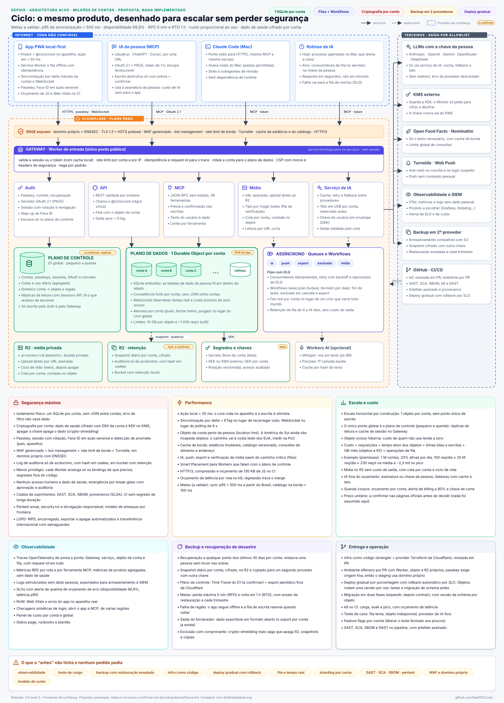

# Arquitetura alvo (proposta)

> **Status: proposta. Nada disto está implementado.** O desenho é [`detalhada/futura.svg`](detalhada/futura.svg), feito no mesmo formato de [`detalhada/atual.svg`](detalhada/atual.svg) para comparar lado a lado. Este texto explica as decisões, o que foi conferido na documentação oficial e a ordem de migração. A versão para apresentação é [`resumida/futura.svg`](resumida/futura.svg), no mesmo layout do `resumida/atual.svg`.



## 1. Para quê
O Ciclo hoje atende uma pessoa e um teste fechado de até 50 contas (#148), a custo zero. A proposta mostra o que mudaria para chegar a **milhões de contas**, com custo proporcional ao uso e **dado de saúde protegido ao máximo**, sem reescrever o produto. A regra de negócio (`packages/core`) continua igual: ela já roda no aparelho e no servidor, e é o que permite migrar o resto aos poucos.

## 2. Metas (a validar, nenhuma é medida hoje)
| Meta | Valor proposto | Observação |
|---|---|---|
| Ação local (marcar série, trocar exercício) | < 50 ms | já vale hoje: o core roda no aparelho |
| Sincronização, p95, a partir do Brasil | < 500 ms | depende da região dos objetos (seção 4.6); medir na prova de conceito |
| Leitura de catálogo na borda | < 100 ms | cache versionado |
| Disponibilidade | 99,9% | com SLO e alerta de queima |
| Perda máxima de dados (RPO) / volta (RTO) | 5 min / 1 h | com ensaio trimestral |
| Custo por conta ativa | proporcional ao uso | conta ociosa custa quase nada |
| Dado de saúde | cifrado por conta | apagar a chave apaga o dado |

## 3. O que foi conferido na documentação oficial (nov/2026)
Cada item abaixo veio das páginas oficiais da Cloudflare, lidas para esta proposta. O que a página **não** confirma fica como "a confirmar" no desenho.

| Recurso | O que a documentação diz | Fonte |
|---|---|---|
| Durable Object com SQLite | até 10 GB por objeto; limite suave de 1.000 req/s por objeto; objetos ilimitados; existe no plano grátis só com SQLite | `developers.cloudflare.com/durable-objects/platform/limits/` |
| Recuperação a um ponto no tempo (PITR) | sim, para objetos com SQLite, **30 dias**, por bookmark | `.../durable-objects/best-practices/access-durable-objects-storage/` |
| Região e jurisdição dos objetos | jurisdições estritas: `eu`, `us`, `fedramp`. **Não há jurisdição Brasil.** A dica `sam` (América do Sul) existe, mas os objetos "atualmente não são criados" lá e vão para um local próximo (exemplo da página: leste da América do Norte). Dica é "melhor esforço" e só a primeira chamada a honra | `.../durable-objects/reference/data-location/` |
| D1 | até 1.000.000 de bancos por conta (100 mil incluídos no plano pago), 10 GB por banco | `.../d1/platform/limits/` |
| D1 com réplicas de leitura | funciona só pela Sessions API (lê o que acabou de escrever); sem custo extra de réplica. **Estado (beta ou GA) não está nas páginas lidas** | `.../d1/best-practices/read-replication/` |
| Queues | disponível no plano grátis (10 mil operações/dia); no pago, 1 milhão de operações por mês incluído, com cobrança por operação de 64 KB; retenção de 24 h no grátis e de 4 a 14 dias no pago; DLQ suportada | `.../queues/platform/pricing/` |
| Workflows | execução durável com retry, `sleep` e espera por evento; disponível no grátis e no pago | `.../workflows/` |
| Deploy gradual | por porcentagem e com rollback. Objetos rodam **uma versão por vez**; sem afinidade de versão, uma pessoa pode alternar entre versões | `.../workers/configuration/versions-and-deployments/gradual-deployments/` |
| AI Gateway | cache, rate limit, retry, fallback de modelo, logs e custo. Guardar chave de provedor: **não confirmado** | `.../ai-gateway/` |
| Secrets Store | segredos de conta; **beta aberto**; integra com Workers e AI Gateway. Detalhe de chave-mestra: não confirmado | `.../secrets-store/` |

**Ainda a confirmar antes de decidir:** preços unitários (nenhum entrou neste desenho), estado das réplicas do D1, Time Travel do D1, bucket com retenção no R2 e se o Smart Placement atende o padrão de acesso. Nenhum número de custo foi assumido.

## 4. Decisões de arquitetura

### 4.1 Dados: um SQLite por conta
**Proposta:** um Durable Object com SQLite por conta para os dados da pessoa, e um D1 global pequeno para o que precisa ser visto de fora de uma conta (contas, passkeys, sessões, OAuth, cotas e o diretório conta → objeto).

| | Objeto por conta (proposta) | D1 por conta | Um D1 grande (hoje) | Postgres com isolamento por linha |
|---|---|---|---|---|
| Isolamento | físico, por construção | físico | por `WHERE user_id` | por regra do banco |
| Escala de escrita | horizontal por conta | horizontal por conta | um escritor | vertical, com custo fixo |
| Tempo real | WebSocket e alarmes no mesmo objeto | precisa de outro serviço | precisa de outro serviço | precisa de outro serviço |
| Conta ociosa | hiberna, custo ~0 | custo ~0 | custo ~0 | custo fixo |
| Consulta entre contas (análise) | **não existe**: precisa de fluxo de eventos | difícil | fácil | fácil |
| Recuperação por conta | PITR de 30 dias | Time Travel (a confirmar) | do banco inteiro | do banco inteiro |
| Migração de schema | por objeto, em código, de forma preguiçosa | por banco | uma vez | uma vez |
| Dependência do fornecedor | alta | alta | alta | menor |

**Por que a proposta:** as 60 tabelas já são divididas por `user_id`, então a migração é mecânica; o isolamento deixa de depender de lembrar um `WHERE`; o tempo real e os alarmes por conta substituem o polling de 8 s e o cron que hoje varre todas as contas.

**Custos reais da escolha, para decidir de olhos abertos:** perde-se a consulta entre contas (métricas de produto passam a vir de eventos agregados, sem dado de saúde), as migrações de schema passam a rodar por objeto e a dependência da Cloudflare aumenta. Por isso o primeiro marco é uma **prova de conceito** com teste de carga comparando objeto por conta, D1 por conta e Postgres, antes de qualquer migração.

### 4.2 Serviços separados atrás de um Gateway
O Worker único vira um **Gateway** (único ponto público: valida sessão ou token, rate limit, idempotência, request-id, roteamento) e serviços ligados por service binding: **Auth**, **API**, **MCP**, **Mídia** e **IA**. Ganho: deploy, falha e permissão isolados (o serviço de mídia não enxerga os segredos do Auth). Custo: mais peças para operar, por isso observabilidade vem antes (marco M0).

### 4.3 Assíncrono: filas e workflows
IA, push, export, exclusão de conta e verificação de mídia saem do caminho da requisição e vão para **Queues** (com DLQ e consumidores idempotentes). Processos longos (fim do teste, exclusão em cascata, export) viram **Workflows**. O cron de 1 minuto que varre todas as contas some: cada conta agenda os próprios alarmes.

### 4.4 Mídia
Upload **direto do app ao R2 por URL assinada** (hoje o arquivo passa pelo Worker), verificação de tipo por conteúdo numa fila, cota por conta contada no objeto da conta e ciclo de vida (lixeira, depois apagar).

### 4.5 IA
O custo de IA já está fora do orçamento (assinatura ou chave da pessoa). Entra um **serviço de IA** com cache, retry, fallback entre provedores e teto em US$ por conta, reservado antes de cada chamada. A chave da pessoa continua em envelope e a saída continua passando pelo validador do core.

### 4.6 Região e residência dos dados (decisão aberta)
Pela documentação lida, **não há como prometer residência no Brasil** com Durable Objects hoje: a região da América do Sul não hospeda objetos e não existe jurisdição Brasil. Consequências:
- **Latência:** a sincronização de quem está no Brasil vai até a costa leste dos EUA. Por isso o app é local-first e a meta é de sincronização (p95 < 500 ms), não de cada ação. A prova de conceito mede o número real.
- **LGPD:** dado de saúde processado fora do Brasil é transferência internacional e exige salvaguardas. **Validar com o jurídico antes do lançamento.**

| Opção | O que muda |
|---|---|
| A. Aceitar a transferência (recomendada para o teste) | salvaguardas contratuais, criptografia por conta com chave sob controle do dono e aviso claro nos termos |
| B. Plano de dados em nuvem com região no Brasil | custo fixo maior e perde o modelo de objeto por conta |
| C. Híbrido | borda e login na Cloudflare, dado de saúde em região brasileira |

### 4.7 Segurança máxima
- **Isolamento físico** por conta (4.1).
- **Criptografia por conta:** dado de saúde cifrado com uma chave da conta; a chave-mestra fica num KMS externo, e a Cloudflare só vê o dado cifrado. Apagar a chave apaga o dado (crypto-shredding), o que simplifica o "apagar minha conta" até nos backups.
- **Auditoria só de acréscimo**, com hash em cadeia, em bucket com retenção.
- **Nenhum acesso humano a dado de saúde.** Emergência só por break-glass com aprovação e registro.
- **Borda:** domínio próprio com DNSSEC, WAF, bot management e rate limit de borda. No `workers.dev` não há WAF, e esse é o buraco que o documento `03-seguranca.md` já registra.
- **Cadeia de suprimentos:** SAST, SCA, SBOM, provenance e CI sem segredo de longa duração.
- **Processo:** modelo de ameaças por fronteira (hoje só a chave de API tem), pentest anual, `security.txt` e divulgação responsável.
- **LGPD:** relatório de impacto, encarregado, exportar e apagar automatizados.

### 4.8 Observabilidade, backup e entrega
Detalhados nos painéis do desenho: traces OpenTelemetry com request-id de ponta a ponta, SLOs com alerta de queima, RUM e checagens sintéticas; recuperação por conta de 30 dias mais snapshot cifrado copiado para um segundo provedor com outra chave; infra como código, ambiente por PR, deploy gradual com rollback por SLO, migração em duas fases, k6 e teste de caos.
**Ponto de atenção:** como objetos rodam uma versão por vez, o deploy gradual não vale para o plano de dados da mesma forma que para os Workers; as migrações de schema precisam ser retrocompatíveis por duas versões.

## 5. Antes e depois, por componente
| Componente | Hoje | Alvo |
|---|---|---|
| Borda | `workers.dev`, sem WAF | domínio próprio, DNSSEC, WAF, bot management, cache de catálogo |
| Computação | 1 Worker com tudo | Gateway + Auth, API, MCP, Mídia e IA |
| Dados da pessoa | 1 D1, 1 região, 60 tabelas | 1 SQLite por conta (Durable Object) |
| Dados globais | no mesmo D1 | D1 de controle, pequeno, com réplicas (a confirmar) |
| Atualização do app | polling a cada 8 s | WebSocket e delta sync |
| Tarefas | cron de 1 min varre todas as contas | alarmes por conta, filas e workflows |
| Mídia | passa pelo Worker | URL assinada, direto ao R2 |
| IA | rotina no Mac e chave própria | serviço de IA com cache, fallback e teto |
| Chaves | KEK em secret do Worker | KEK em KMS externo e chave por conta |
| Observabilidade | logs do Workers | traces, métricas, SLO, RUM e sintético |
| Backup | nenhum documentado | PITR de 30 dias + snapshot em 2 provedores |
| Entrega | deploy manual | IaC, ambiente por PR, deploy gradual, rollback por SLO |
| Teste de carga | medição local do D1 | k6 no CI com orçamento de latência |
| Análise de segurança | testes e gitleaks | + SAST, SCA, SBOM, DAST e pentest |

## 6. O que a geração com IA não fez, e por quê
O "antes" saiu forte onde o pedido era claro e o repositório tinha regras: o agente revisor de segurança e o `CLAUDE.md` seguram isolamento, validação e privacidade, e o resultado tem 1.000 testes (`npm test`, 22/11/2026). As lacunas abaixo são o que **fica fora do código das funcionalidades**: ninguém pediu, e uma geração de código só entrega o que o pedido e o contexto mencionam.

| Lacuna | Evidência (levantada no repositório em 22/11/2026) | Como entra |
|---|---|---|
| Observabilidade | só `observability: { enabled: true }` no `wrangler.jsonc` | marco M0 |
| Teste de carga | só medição local (`/api/state` em 4 ms); Lighthouse ficou como passo manual do dono | marco M0 |
| Backup e restauração | busca por backup, restauração, RPO e RTO nos docs: nenhuma menção | marco M0 |
| Infra como código | deploy por checklist (`docs/05`); alerta de billing é manual | marco M0 |
| Deploy seguro | deploy manual, sem canário nem rollback | marco M7 |
| Fila e tempo real | o ambiente só tem D1, R2, IA e assets; a caixa de pedidos é tabela lida por polling | marcos M3 e M5 |
| Escala de dados | um D1, uma região, um cron para todas as contas | marco M4 |
| Análise de segurança | o CI roda testes e gitleaks | marco M6 |
| WAF e anti-bot de borda | não existem no `workers.dev` (registrado em `docs/03`) | marco M1 |
| Modelo de custo | só a trava de 95% da cota grátis | seção 8 |

## 7. Distribuição: quem faz o quê
1. **Cliente** envia a ação (local-first, otimista) com um id de idempotência.
2. **Borda** descarta o que o WAF e o rate limit barram e serve o que está em cache.
3. **Gateway** valida sessão ou token, aplica o limite por conta e roteia para o serviço.
4. **Serviço** (API ou MCP) chama o `@ciclo/core` e fala com o **objeto da conta**, que decide, grava e notifica por WebSocket.
5. **Fila** recebe o que não precisa ser síncrono (IA, push, export, mídia) e os consumidores respondem de volta ao objeto da conta.
6. **Plano de controle** só é consultado para identidade e cota, com cache no Gateway.

Não há ponto único de escrita para dado de pessoa: o gargalo possível é o plano de controle, por isso ele é pequeno, replicado para leitura e cacheado.

## 8. Modelo de custo (fórmula, sem preço)
```
custo_mês ≈ requisições          × preço_req
          + tempo_ativo_objetos  × preço_duração   (hiberna quando ocioso)
          + linhas_lidas         × preço_leitura
          + linhas_escritas      × preço_escrita
          + GB_mês (objetos + R2) × preço_armazenamento
          + operações_de_fila    × preço_op
          + custo_fixo (domínio, observabilidade, ferramentas de segurança, backup em 2º provedor)
```
Exemplo de capacidade, **com premissas explícitas**: 1 milhão de contas, 20% ativas por dia e 100 requisições por conta ativa por dia dão cerca de 20 milhões de requisições por dia, ≈ 230 por segundo na média e ≈ 2,3 mil no pico (fator 10). Dezenas de requisições por dia por objeto ficam muito abaixo do limite suave de 1.000 por segundo por objeto. Os preços unitários devem ser lidos nas páginas oficiais na hora da decisão. Guarda-corpos: orçamento por conta, alerta de billing a 80% e chave de corte.

## 9. Migração em marcos (sem parar o app)
Estratégia: **estrangulamento** (cada peça nova entra atrás do Gateway e assume uma rota por vez) e **escrita dupla** na troca do banco, com a regra do `@ciclo/core` intacta.

| Marco | Entrega | Critério de saída |
|---|---|---|
| M0 · Base operacional | observabilidade, backup com restauração ensaiada, infra como código, k6 de linha de base | restauração feita e documentada; painel de SLO ligado; relatório de carga atual |
| M1 · Borda | domínio próprio, WAF, rate limit de borda e cache de catálogo | testes de força bruta barrados na borda; passkey funcionando na nova origem |
| M2 · Gateway e serviços | separar Auth, API, MCP, Mídia e IA por service binding | contratos testados; rollback por rota |
| M3 · Filas e workflows | IA, push, export, exclusão e verificação de mídia assíncronos | DLQ vazia em operação normal; saga de exclusão com comprovante |
| M4 · Plano de dados | **prova de conceito** (objeto por conta × D1 por conta × Postgres), decisão e migração com escrita dupla | latência, custo e operação medidos; migração de uma conta de teste de ponta a ponta |
| M5 · Tempo real | WebSocket e delta sync no lugar do polling | queda de requisições medida; app continua offline-first |
| M6 · Segurança máxima | criptografia por conta, KMS, auditoria, SAST, SCA, SBOM, DAST e pentest | crypto-shredding testado; achados críticos zerados |
| M7 · Entrega | deploy gradual, rollback por SLO, ambiente por PR, teste de caos | rollback automático exercitado em staging |
| M8 · Escala | teste de carga no alvo, ensaio de região e decisão de residência | metas da seção 2 atingidas ou revistas com número |

M0 pode começar já, antes de qualquer escala, porque não depende de nenhuma decisão em aberto.

## 10. Riscos e perguntas em aberto
1. **Banco:** o objeto por conta é a recomendação, mas a prova de conceito pode contradizer. Critério: latência a partir do Brasil, custo por conta ativa e esforço de operação.
2. **Residência e LGPD:** sem jurisdição Brasil, decidir entre A, B e C (4.6) com o jurídico.
3. **Dependência de fornecedor:** o desenho é fortemente Cloudflare. A mitigação é o snapshot em outro provedor, o formato aberto de export e o core sem dependência de plataforma.
4. **Complexidade operacional:** mais peças exigem observabilidade e plantão antes de crescer (por isso M0 vem primeiro).
5. **Recursos em beta:** Secrets Store é beta; réplicas do D1 e bucket com retenção estão a confirmar. Nenhum caminho crítico depende só deles.
6. **Equipe:** a proposta supõe uma pessoa mais IA. A partir do M6 vale ter revisão externa de segurança.

## 11. Como atualizar
`detalhada/fonte/gerar_futura.py` gera o SVG (`python3 -I docs/arquitetura/detalhada/fonte/gerar_futura.py docs/arquitetura/detalhada/futura.svg`). As alturas dos cartões se ajustam ao texto. Mudou uma decisão aqui, muda no gerador no mesmo PR.
